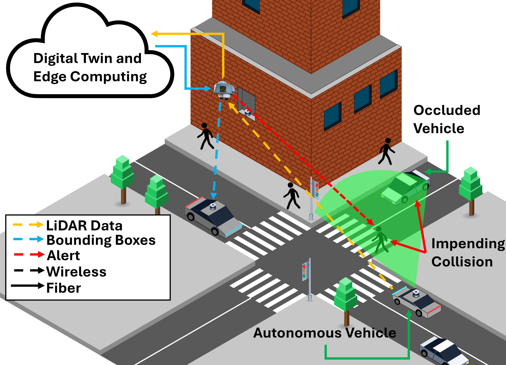

# `gr-LiDAR`: For real-time edge-cloud inference on LiDAR point clouds  

Need to transport LiDAR or other sensor data wirelessley and process it on the edge? `gr-LiDAR` is here for you! This work is associated with a [paper](https://events.gnuradio.org/event/28/contributions/872/attachments/271/715/Hermtein_GRCon26_gr-lidar.pdf) and talk given at GNU Radio Conference 2026. If you use our code, please cite us:

> K. Hermstein and G. Zussman. “Real-Time LiDAR Data Transmission to the Edge over mmWave”, In Proc. GNU Radio Conference’26, Raleigh, NC, Sept. 2026.

The talk can be found [here](https://www.youtube.com/live/atQRbQlTdZk?si=J1Cz03fh6JvPWfz3&t=6200) along with a [video demo](https://www.youtube.com/watch?v=xDvC7DUvTg8) of the full system.

## Features

* An OOT module for transmitting and receiving data over OFDM
* An additional block for translating received data into a standard format
* A Python script to visualize the received LiDAR data in a point cloud
* A C++ API for running real-time object detection with PointPillars on the LiDAR point cloud on NVIDIA GPUs
* A Python script to invoke the C++ API to plot the point cloud along with bounding boxes on detected objects

## Getting Started

To use `gr-LiDAR` on your systsem, follow the steps below

### Prerequisites

The following must be installed to use the OOT module

* GNU Radio
* Volk, Eigen, FFTW (Probably already installed if you have GNU Radio)

To also run the real time visualization scripts you will need

* OpenGL
* PyQT

To run the object detection (which is still be standardized for other users) you will need

* CUDA
* CudaDNN

### Instructions

#### Building

1. Clone the repo `git clone` [https://github.com/khermstein/gr-lidar](https://github.com/khermstein/gr-lidar)
2. Navigate to the repo root `cd gr-lidar`
2. Build the module `mkdir build; cd build; cmake ..; make -j<jobs>; sudo make install; sudo ldconfig;`
